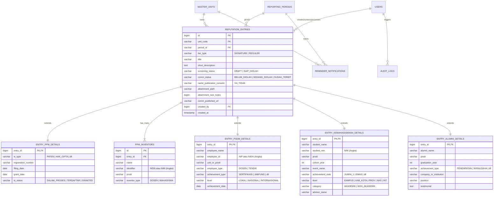

# SPESIFIKASI SISTEM DAN ARSITEKTUR ERP
## Modul Inventarisasi Data Pendukung Branding & Reputasi Institusi
**Universitas Harkat Negeri — Tim Task Force Kerjasama Internasional & Reputasi Institusi**

---

## 1. PENDAHULUAN & ARSITEKTUR UMUM

### 1.1 Tujuan Sistem
Sistem ini dirancang untuk:
1. **Mengorkestrasi pengumpulan data capaian institusi** secara terdesentralisasi dari 4 unit strategis (*PPM*, *PSDM*, *Kemahasiswaan*, dan *Alumni Karir*) melalui mekanisme *screening* internal yang ketat.
2. **Memfasilitasi Bagian Komunikasi** dalam mengkurasi dan mengolah data capaian mentah menjadi produk publikasi (siaran pers, artikel web portal, infografis media sosial, serta laporan capaian tridarma).
3. **Menyediakan repositori bukti sahih (*evidence-based repository*)** untuk pemenuhan instrumen borang pemeringkatan internasional (*Webometrics*, *Uniranks*, dan *WURI - World University Rankings for Innovation*).
4. **Menerapkan tata kelola data berbasis target** dengan kewajiban setor minimal 1 data unggulan (*Signature*) per unit per bulan sepanjang periode pelaporan aktif (September 2026 s.d. Agustus 2027).

```
+----------------------------------------------------------------------------------------------------+
|                                     ALUR KERJA & BISNIS PROSES                                     |
+----------------------------------------------------------------------------------------------------+
|                                                                                                    |
|  [UNIT PENGHASIL]              [SCREENING INTERNAL]             [BAGIAN KOMUNIKASI]                |
|  - PPM (HKI/Paten/Riset)   --> PIC Unit melakukan verifikasi -> Data "Siap Diolah" masuk ke        |
|  - PSDM (Dosen/Tendik)         kelayakan publikasi.             Meja Kerja Kurasi.                 |
|  - Kemahasiswaan (Lomba)       Pilih tier: Signature / Reguler. Status: Belum -> Sedang -> Terbit. |
|  - Alumni (Karir/Bisnis)       Draft -> Siap Diolah.            Input URL publikasi hasil.         |
|                                                                                                    |
|                                       +-----------------------+                                    |
|                                       | TIM TASK FORCE & LEAD |                                    |
|                                       +-----------------------+                                    |
|                                       * Monitoring Progress Meter (Signature terpenuhi/belum)      |
|                                       * Rekapitulasi Borang Pemeringkatan (WURI/Uniranks)          |
|                                       * Ekspor Excel/CSV & Notifikasi Otomatis                     |
+----------------------------------------------------------------------------------------------------+
```

---

## 2. SKEMA DATABASE RELASIONAL (DDL & ERD)

Sistem menggunakan pola arsitektur **Table Inheritance / Shared-Header Normalized Pattern** untuk menjamin konsistensi audit trail, alur screening, dan privasi, sekaligus memberikan fleksibilitas atribut spesifik per unit.

### 2.1 Diagram Entitas Relasi (Mermaid ERD)



### 2.2 Kamus Data Entitas Utama

| Nama Tabel | Deskripsi | Volume Prediksi (Tahunan) |
| :--- | :--- | :--- |
| `master_units` | Referensi unit kerja (PPM, PSDM, Kemahasiswaan, Alumni, Komunikasi, Task Force). | < 20 baris |
| `reporting_periods` | 12 Periode bulanan: September 2026 s.d. Agustus 2027. | 12 baris / tahun |
| `users` | Akun pengguna sistem terdistribusi per unit dan peran. | 20 - 50 akun |
| `reputation_entries` | Master data capaian reputasi (induk untuk semua modul). | 200 - 1.000 baris / tahun |
| `entry_ppm_details` | Ekstensi atribut kekayaan intelektual PPM. | Sesuai entri PPM |
| `ppm_inventors` | Relasi One-to-Many untuk inventor/pencipta (bisa multi dosen/mahasiswa). | 2 - 5 per entri PPM |
| `entry_psdm_details` | Ekstensi atribut capaian dosen/tendik PSDM. | Sesuai entri PSDM |
| `entry_kemahasiswaan_details` | Ekstensi atribut capaian prestasi mahasiswa. | Sesuai entri Kemahasiswaan |
| `entry_alumni_details` | Ekstensi atribut kiprah dan karir alumni. | Sesuai entri Alumni |
| `audit_logs` | Catatan rekaman aksi (CREATE, UPDATE, DELETE, VIEW_PII, EXPORT). | 5.000 - 20.000 baris |
| `reminder_notifications` | Rekaman pengiriman notifikasi pengingat mid-month & end-month. | 96 baris / tahun |

---

## 3. DAFTAR HALAMAN, MENU, DAN ALUR NAVIGASI

### 3.1 Peta Situs (Sitemap Berdasarkan Role)

```
[PORTAL UTAMA ERP UNIVERSITAS HARKAT NEGERI]
│
├── 1. AUTENTIKASI
│   ├── Login SSO / Kredensial
│   ├── Lupa Kata Sandi
│   └── Profil Pengguna & Ganti Password
│
├── 2. DASHBOARD
│   ├── Ringkasan Eksekutif (Semua Role)
│   ├── "Progress Meter" Bulanan per Unit (Indikator Signature ✓/✗)
│   └── Antrian Pengolahan Komunikasi (Statistik Masuk vs Terbit)
│
├── 3. INVENTARISASI UNIT (Menu PIC Unit & Admin)
│   ├── Modul PPM (Paten, HKI & Riset)
│   │   ├── Daftar Capaian PPM
│   │   ├── Form Input/Edit Capaian PPM (+ Dinamis Tambah Inventor)
│   │   └── Detail & Unduh Bukti Sertifikat
│   ├── Modul PSDM (Capaian Pegawai)
│   │   ├── Daftar Capaian Pegawai (Dosen & Tendik)
│   │   ├── Form Input/Edit Capaian PSDM
│   │   └── Detail & Bukti Pendukung
│   ├── Modul Kemahasiswaan (Prestasi Mahasiswa)
│   │   ├── Daftar Prestasi Mahasiswa
│   │   ├── Form Input/Edit Prestasi Mahasiswa
│   │   └── Detail & Foto/Sertifikat Kejuaraan
│   └── Modul Alumni Karir (Kiprah Alumni)
│       ├── Daftar Capaian Alumni
│       ├── Form Input/Edit Capaian Alumni
│       └── Detail & Testimoni
│
├── 4. MEJA KERJA KURASI KOMUNIKASI (Khusus Tim Komunikasi & Admin)
│   ├── Antrian Data Siap Diolah (Filter Unit & Bulan)
│   ├── Lembar Kurasi Konten & Deteksi Consent Privasi
│   ├── Update Status Pengolahan (Belum -> Sedang -> Terbit)
│   └── Input Tautan Publikasi Berita/Medsos
│
├── 5. REKAPITULASI & EKSPOR DATA (Task Force, Komunikasi, Pimpinan)
│   ├── Ekspor Master Capaian (Excel / CSV)
│   ├── Formulasi Borang WURI (World University Rankings for Innovation)
│   └── Rekap Capaian Webometrics & Uniranks
│
└── 6. PENGATURAN & AUDIT (Khusus Admin Task Force)
    ├── Manajemen Akun Pengguna & Unit
    ├── Periode Pelaporan Aktif
    ├── Log Audit & Akses Data Pribadi
    └── Konfigurasi Jadwal Notifikasi Pengingat
```

---

## 4. MATRIKS ROLE DAN HAK AKSES (RBAC & PRIVACY RULES)

### 4.1 Tabel Matriks Izin Akses (RBAC Matrix)

| Fitur / Tindakan | Admin Task Force | PIC PPM | PIC PSDM | PIC Kemahasiswaan | PIC Alumni | Bagian Komunikasi | Viewer (Pimpinan) |
| :--- | :---: | :---: | :---: | :---: | :---: | :---: | :---: |
| **Lihat Dashboard Progress Meter** | Semua | Unit Sendiri | Unit Sendiri | Unit Sendiri | Unit Sendiri | Semua Unit | Semua (Ringkasan) |
| **Input Data Capaian Unit** | Semua Unit | PPM Saja | PSDM Saja | Kemhs Saja | Alumni Saja | ✗ | ✗ |
| **Edit Data Status "Draft"** | Semua Unit | PPM Saja | PSDM Saja | Kemhs Saja | Alumni Saja | ✗ | ✗ |
| **Ubah Status ke "Siap Diolah" (Screening)** | Semua Unit | PPM Saja | PSDM Saja | Kemhs Saja | Alumni Saja | ✗ | ✗ |
| **Tarik Kembali ke "Draft"** | Ya | Ya (Jika blm terbit) | Ya (Jika blm terbit) | Ya (Jika blm terbit) | Ya (Jika blm terbit) | ✗ | ✗ |
| **Lihat Data Unit Lain** | Ya | ✗ | ✗ | ✗ | ✗ | Ya (Semua) | Ya (Read-only) |
| **Ubah Status Pengolahan Komunikasi** | Ya | ✗ | ✗ | ✗ | ✗ | Ya | ✗ |
| **Input Tautan Publikasi Terbit** | Ya | ✗ | ✗ | ✗ | ✗ | Ya | ✗ |
| **Lihat PII Lengkap (NIM, NIP, NIDN)** | Ya | PPM (Miliknya) | PSDM (Miliknya) | Kemhs (Miliknya) | Alumni (Miliknya)| Terbatas | Dimaskir (****) |
| **Peringatan Consent Publikasi Nama** | Muncul Alert | Muncul Alert | Muncul Alert | Muncul Alert | Muncul Alert | **BLOCK BANNER** | Watermark |
| **Ekspor Excel / CSV / Borang WURI** | Ya | Data Unit | Data Unit | Data Unit | Data Unit | Ya | Ya (Ringkasan) |
| **Kelola Pengguna & Setting Periode** | Ya | ✗ | ✗ | ✗ | ✗ | ✗ | ✗ |
| **Akses Log Audit & Backup** | Ya | ✗ | ✗ | ✗ | ✗ | ✗ | ✗ |

### 4.2 Kebijakan Privasi & Perlindungan Data Pribadi (UU PDP Compliant)
1. **Persetujuan Publikasi Nama (*Consent Flag*)**:
   - Tiap entri wajib memiliki nilai: `Ya` atau `Tidak`.
   - Jika `Tidak`:
     - Pada layar **Bagian Komunikasi**, sistem menampilkan **Banner Merah mencolok**:
       > ⚠️ **PERINGATAN PRIVASI (RESTRICTED PUBLICATION):**
       > Subjek data **TIDAK MENYETUJUI** publikasi nama pribadi. Jangan gunakan nama lengkap pada artikel/siaran pers/media sosial eksternal! Gunakan inisial atau deskripsi kelompok (Contoh: "Tim Mahasiswa Teknik Lingkungan", "Salah seorang Dosen Farmasi").
     - Pada ekspor publik atau laporan terbuka, identitas nama dimaskir otomatis menjadi inisial (misal: `N**** H*******`).
2. **Masking NIP / NIDN / NIM**:
   - Kolom nomor identitas pribadi hanya ditampilkan lengkap untuk Admin dan PIC unit pemilik. Pada peran *Viewer (Pimpinan)* atau ekspor umum, digit tengah otomatis disensor (misal: `1982****001`).
3. **Audit Trail Logging**:
   - Setiap kali Bagian Komunikasi atau Admin mengekspor data yang memuat identitas personil, sistem mencatat *timestamp*, *IP address*, dan *user ID* ke dalam tabel `audit_logs`.

---

## 5. WIREFRAME TEKS PER HALAMAN UTAMA

### 5.1 Wireframe Halaman 1: Dashboard "Progress Meter"

```
+==================================================================================================+
|  [LOGO UHN]  ERP REPUTASI INSTITUSI - UNIVERSITAS HARKAT NEGERI               [User: Tim Komunikasi] |
+==================================================================================================+
|  Periode Aktif: [ Oktober 2026 v ]       Rentang: 01 Okt 2026 - 31 Okt 2026       [Sisa: 19 Hari] |
+--------------------------------------------------------------------------------------------------+
|                                                                                                  |
|  [ SUMMARY METRICS ]                                                                             |
|  +--------------------+  +--------------------+  +--------------------+  +---------------------+ |
|  | TOTAL DATA MASUK   |  | TARGET SIGNATURE   |  | PERLU DIOLAH (KOM) |  | SUDAH TERBIT        | |
|  | 12 Entri           |  | 4 / 4 Unit         |  | 5 Entri            |  | 4 Entri             | |
|  | (+3 dr bln lalu)   |  | [100% TERPENUHI ✓] |  | (Siap Diolah)      |  | (Di Portal & Medsos)| |
|  +--------------------+  +--------------------+  +--------------------+  +---------------------+ |
|                                                                                                  |
|  [ TABEL PROGRESS METER PER UNIT - OKTOBER 2026 ]                                                |
|  +----------------+-------------+------------------+-------------+-------------+---------------+ |
|  | UNIT KERJA     | TOTAL DATA  | TARGET SIGNATURE | SIAP DIOLAH | SEDANG OLAH | STATUS KOM    | |
|  +----------------+-------------+------------------+-------------+-------------+---------------+ |
|  | PPM            | 3 Data      | [✓] TERPENUHI (1)| 1 Data      | 1 Data      | 1 Terbit      | |
|  | PSDM           | 3 Data      | [✓] TERPENUHI (1)| 0 Data      | 1 Data      | 1 Terbit      | |
|  | KEMAHASISWAAN  | 3 Data      | [✓] TERPENUHI (1)| 2 Data      | 0 Data      | 1 Terbit      | |
|  | ALUMNI KARIR   | 3 Data      | [✓] TERPENUHI (1)| 0 Data      | 1 Data      | 1 Terbit      | |
|  +----------------+-------------+------------------+-------------+-------------+---------------+ |
|                                                                                                  |
|  [ STATUS PENYETORAN TARGET BULANAN ]                                                            |
|  Catatan Task Force: Setiap unit wajib menyetor minimal 1 data berstatus "Signature" per bulan.  |
|  Notifikasi Pengingat Otomatis dijadwalkan pada:                                                 |
|  - Mid-Month Reminder: 15 Oktober 2026 (Pukul 09:00 WIB)                                         |
|  - End-Month Reminder: 26 Oktober 2026 (Pukul 09:00 WIB)                                         |
|                                                                                                  |
|  [ANTRIAN CEPAT BAGIAN KOMUNIKASI]                                                               |
|  * [PPM] Hak Cipta: Buku Ajar Interaktif Etika Bisnis (Sedang Diolah)               [Buka Kurasi] |
|  * [KEMHS] Medali Emas POMNAS Catur (Siap Diolah - Belum Dikerjakan)                [Buka Kurasi] |
|  * [KEMHS] Juara 2 Data Science AI (Siap Diolah - ! CONSENT TIDAK)                  [Buka Kurasi] |
+==================================================================================================+
```

---

### 5.2 Wireframe Halaman 2: Form Input/Edit Capaian Unit (Contoh: Modul PPM)

```
+==================================================================================================+
|  [<- Kembali ke Daftar]    INPUT CAPAIAN KEKAYAAN INTELEKTUAL & RISET (PPM)     [Mode: Tambah Data]|
+==================================================================================================+
|                                                                                                  |
|  BULAN PELAPORAN *: [ Oktober 2026              v ]  (Periode Pelaporan Aktif Sep 2026 - Agu 2027)|
|  STATUS TIER     *: (•) Signature (Unggulan Bulanan)     ( ) Reguler                             |
|                                                                                                  |
|  --- INFORMASI UTAMA KEKAYAAN INTELEKTUAL ---                                                    |
|  Jenis KI        *: [ Paten                                                v ]                   |
|                     Pilihan: Paten / Paten Sederhana / Hak Cipta / Merek / Desain Industri / Lain|
|  Judul Capaian   *: [ Alat Sortir Kopi Berbasis AI Berdaya Rendah (Agritech)                 ]   |
|  No. Pendaftaran *: [ IDP000088921                                                           ]   |
|  Status KI       *: [ Granted                                              v ]                   |
|                     Pilihan: Dalam Proses / Terdaftar / Granted                                  |
|  Tanggal Daftar  *: [ 2025-03-12    [Kalender] ]    Tanggal Terbit: [ 2026-09-28   [Kalender] ]   |
|                                                                                                  |
|  --- PENCIPTA / INVENTOR (Bisa multi-orang) ---                                                  |
|  +----+------------------------------+------------+--------------------+-----------+-----------+ |
|  | No | Nama Lengkap                 | NIDN / NIM | Program Studi      | Tipe      | Aksi      | |
|  +----+------------------------------+------------+--------------------+-----------+-----------+ |
|  | 1. | Dr. Ir. Ahmad Baiquni, M.T.  | 0012057801 | Teknik Elektro     | [Dosen v] | [Hapus]   | |
|  | 2. | Muhammad Fathur              | 230105021  | Teknik Informatika | [Mhs   v] | [Hapus]   | |
|  +----+------------------------------+------------+--------------------+-----------+-----------+ |
|  [ + Tambah Inventor Baru ]   *(Validasi: NIDN/NIM wajib angka, tidak boleh ada karakter huruf)   |
|                                                                                                  |
|  --- NARASI & BUKTI PENDUKUNG ---                                                                |
|  Deskripsi Singkat (Maksimal 3 kalimat, bahasa awam untuk rilis media) *:                        |
|  +---------------------------------------------------------------------------------------------+ |
|  | Inovasi mesin sortir cerdas yang mampu mendeteksi biji kopi cacat dalam hitungan milidetik | |
|  | secara presisi. Telah diuji coba pada 5 kelompok tani binaan dan meningkatkan efisiensi     | |
|  | panen hingga 40%. Teknologi ini merupakan kolaborasi riset dosen dan mahasiswa.             | |
|  +---------------------------------------------------------------------------------------------+ |
|  Karakter terpakai: 278 | Kalimat terdeteksi: 3/3                                                |
|                                                                                                  |
|  Unggah Bukti Sertifikat (PDF, Maks. 10 MB) *:                                                   |
|  [ Choose File ] Sertifikat_Paten_IDP000088921.pdf (3.0 MB)   [✓ Valid PDF]                      |
|  Tautan Pendukung / Pangkalan Data KI (Opsional):                                                |
|  [ https://pdki-indonesia.dgip.go.id/detail/IDP000088921                                      ]  |
|                                                                                                  |
|  --- PRIVASI & WORKFLOW SCREENING UNIT ---                                                       |
|  Persetujuan Publikasi Nama Individu *:                                                          |
|  (•) YA - Subjek mengizinkan nama dipublikasikan di media massa & website kampus                 |
|  ( ) TIDAK - Subjek meminta anonimitas / inisial dalam siaran publik                             |
|                                                                                                  |
|  Catatan Internal Unit:                                                                          |
|  [ Prioritas siaran pers dan borang WURI Industrial Application.                              ]  |
|                                                                                                  |
|  STATUS SCREENING UNIT *:                                                                        |
|  ( ) Simpan sebagai DRAFT (Belum masuk antrian Komunikasi)                                       |
|  (•) SIAP DIOLAH (Kirim ke Bagian Komunikasi untuk diproses rilis)                               |
|                                                                                                  |
|  [ Batal ]                                           [ SIMPAN & SUBMIT KE KOMUNIKASI ]           |
+==================================================================================================+
```

---

### 5.3 Wireframe Halaman 3: Meja Kerja Kurasi Bagian Komunikasi

```
+==================================================================================================+
|  [<- Kembali ke Antrian]           MEJA KERJA KURASI KONTEN PUBLIKASI            [User: Komunikasi] |
+==================================================================================================+
|  ID Entri: #303  |  Unit Asal: KEMAHASISWAAN  |  Bulan: Oktober 2026  |  Tier: REGULER           |
+--------------------------------------------------------------------------------------------------+
|                                                                                                  |
|  !!!!!!!!!!!!!!!!!!!!!!!!!!!!!!!!!!!!!!!!!!!!!!!!!!!!!!!!!!!!!!!!!!!!!!!!!!!!!!!!!!!!!!!!!!!!!!  |
|  ! ⚠️ PERINGATAN PRIVASI (RESTRICTED PUBLICATION):                                             !  |
|  ! Mahasiswa/Subjek menyatakan: [ TIDAK SETUJU PUBLIKASI NAMA PRIBADI ]                        !  |
|  ! ATURAN KONTEN: Dilarang menyebutkan nama "Nurul Hidayati" di media publik, siaran pers,     !  |
|  ! feed Instagram, maupun artikel website. Gunakan redaksi: "Tim Mahasiswa Sistem Informasi". !  |
|  !!!!!!!!!!!!!!!!!!!!!!!!!!!!!!!!!!!!!!!!!!!!!!!!!!!!!!!!!!!!!!!!!!!!!!!!!!!!!!!!!!!!!!!!!!!!!!  |
|                                                                                                  |
|  [ RINGKASAN DATA MASUK DARI UNIT ]                                                              |
|  * Judul Capaian    : Juara 2 National Data Science & AI Challenge 2026                          |
|  * Kategori/Tingkat : Akademik / NASIONAL                                                        |
|  * Penyelenggara    : Asosiasi Data Science Indonesia (ADSI)                                     |
|  * Tanggal Event    : 29 September 2026                                                          |
|  * Subjek / Peserta : Nurul Hidayati (NIM: 220108044) - Prodi: Sistem Informasi                 |
|  * Pembimbing       : Anindya Kirana, M.Kom.                                                     |
|  * Narasi Unit      : Mengembangkan model deteksi fraud transaksi keuangan dengan algoritma       |
|                       ensemble learning berakurasi 98,7%. Menyisihkan 120 tim se-Indonesia.      |
|  * Lampiran Bukti   : [Lihat PDF Sertifikat (3.2 MB)] [Buka Tautan Eksternal]                    |
|                                                                                                  |
|  ---------------------------------------------------------------------------------------------   |
|  [ FORM PEMUTAKHIRAN STATUS PENGOLAHAN KOMUNIKASI ]                                              |
|                                                                                                  |
|  Status Pengolahan *:                                                                            |
|  [ Sedang Diolah                              v ]                                                |
|  Pilihan: Belum Diolah / Sedang Diolah / Sudah Terbit                                            |
|                                                                                                  |
|  Rencana Kanal Publikasi:                                                                        |
|  [X] Website Resmi Kampus    [X] Siaran Pers Nasional    [ ] Instagram Feeds    [X] LinkedIn     |
|                                                                                                  |
|  Tautan Publikasi Hasil (Wajib diisi jika status "Sudah Terbit"):                                |
|  [ https://harkatnegeri.ac.id/berita/mahasiswa-si-raih-prestasi-ai-nasional                   ]  |
|                                                                                                  |
|  Catatan Kurator Komunikasi:                                                                     |
|  [ Draft naskah rilis telah disesuaikan tanpa menyebut nama pribadi. Menunggu review Kabag.   ]  |
|                                                                                                  |
|  Audit Trail: Disubmit oleh PIC Kemahasiswaan pada 11 Okt 2026, 13:00 WIB                        |
|                                                                                                  |
|  [ Batal ]                                                [ SIMPAN PERUBAHAN STATUS PENGOLAHAN ] |
+==================================================================================================+
```

---

### 5.4 Wireframe Halaman 4: Filter, Pencarian, & Ekspor Borang WURI / Excel

```
+==================================================================================================+
|  [FILTER & EKSPOR DATA CAPAIAN REPUTASI]                                       [Role: Admin / TF]|
+==================================================================================================+
|  FILTER PENCARIAN CEPAT:                                                                         |
|  Unit Kerja     : [ Semua Unit Kerja          v ]  Bulan Pelaporan: [ Oktober 2026          v ]  |
|  Tier Capaian   : [ Semua (Signature/Reguler) v ]  Tingkat        : [ Semua Tingkat         v ]  |
|  Status Screening: [ Siap Diolah               v ]  Status Kom     : [ Semua Status           v ]  |
|  Kata Kunci Cari: [ kecerdasan buatan                                      ] [ Terapkan Filter ] |
+--------------------------------------------------------------------------------------------------+
|                                                                                                  |
|  Ditemukan: 3 Data Capaian Sesuai Kriteria                                                       |
|                                                                                                  |
|  [ PILIHAN FORMAT EKSPOR ]:                                                                      |
|  (•) Format Rekap Eksekutif (Excel .xlsx - Seluruh Kolom & Audit Trail)                          |
|  ( ) Format Borang WURI (World University Rankings for Innovation)                               |
|      Kategori WURI Terpilih: [ Industrial Application & Student Mobility v ]                     |
|  ( ) Format Tabulasi Webometrics / Uniranks Evidence                                             |
|  ( ) Format CSV Standar (Untuk Olah Data SPSS/R)                                                 |
|                                                                                                  |
|  [ Opsi Privasi Ekspor ]: [X] Sensor otomatis NIP/NIM/NIDN bagi entri tanpa consent publik       |
|                                                                                                  |
|  [ DOWNLOAD FILE EKSPOR ]                                                                        |
|                                                                                                  |
|  PREVIEW DATA TABEL (3 Teratas):                                                                 |
|  +----+---------+-----------+-----------------------------------+------------+-----------------+ |
|  | ID | Unit    | Tier      | Judul Capaian                     | Status Kom | Tautan Rilis    | |
|  +----+---------+-----------+-----------------------------------+------------+-----------------+ |
|  | 101| PPM     | SIGNATURE | Alat Sortir Kopi Berbasis AI      | Terbit     | [harkatnegeri..]| |
|  | 201| PSDM    | SIGNATURE | Keynote Speaker UNESCO Paris      | Terbit     | [harkatnegeri..]| |
|  | 301| KEMHS   | SIGNATURE | Emas WYIIA 2026 Malaysia          | Terbit     | [harkatnegeri..]| |
|  +----+---------+-----------+-----------------------------------+------------+-----------------+ |
+==================================================================================================+
```

---

## 6. DATA DUMMY KOMPREHENSIF (3 BARIS PER MODUL)

Tabel berikut merangkum data pengujian yang mewakili skenario *Signature/Reguler*, *Dosen/Mahasiswa/Tendik*, tingkatan lokal/nasional/internasional, variasi *consent* privasi, dan alur publikasi komunikasi:

### 6.1 Modul 1 — PPM (Paten, HKI, Riset)
| No | Judul & No. Reg | Jenis & Status | Pencipta / Inventor | Tgl Daftar / Terbit | Tier & Consent | Screening & Komunikasi |
| :---: | :--- | :--- | :--- | :---: | :---: | :---: |
| **1** | **Alat Sortir Kopi Berbasis AI Berdaya Rendah**<br>`IDP000088921` | Paten<br>(Granted) | 1. Dr. Ir. Ahmad Baiquni, M.T. (Dosen - 0012057801)<br>2. Muhammad Fathur (Mhs - 230105021) | 12/03/2025<br>28/09/2026 | **SIGNATURE**<br>Consent: **YA** | Siap Diolah<br>**Sudah Terbit**<br>[harkatnegeri.ac.id/berita/paten-ai-kopi] |
| **2** | **Hak Cipta: Buku Ajar Interaktif Etika Bisnis Metaverse**<br>`EC0020269910` | Hak Cipta<br>(Terdaftar) | Dr. Ratna Susilowati, S.E., M.M. (Dosen - 0019088203) | 10/09/2026<br>02/10/2026 | REGULER<br>Consent: **YA** | Siap Diolah<br>**Sedang Diolah** |
| **3** | **Paten Sederhana: Formula Gel Herbal Ekstrak Manggis**<br>`P0020260771` | Paten Sederhana<br>(Dalam Proses) | Apt. Farida Khairunnisa, M.Farm. (Dosen - 0024048901) | 15/08/2026<br>- | REGULER<br>Consent: **TIDAK** | **Draft**<br>Belum Diolah |

### 6.2 Modul 2 — PSDM (Capaian Pegawai)
| No | Pegawai, NIP & Unit | Jenis Capaian & Judul | Penyelenggara & Tingkat | Tanggal | Tier & Consent | Screening & Komunikasi |
| :---: | :--- | :--- | :--- | :---: | :---: | :---: |
| **1** | Prof. Dr. Ir. Teguh Wicaksono, M.Eng.<br>`197508101999031002`<br>Dosen - T. Informatika | **Narasumber (Keynote)**<br>Forum UNESCO on AI Ethics in Higher Education | UNESCO HQ Paris<br>**INTERNASIONAL** | 25/09/2026 | **SIGNATURE**<br>Consent: **YA** | Siap Diolah<br>**Sudah Terbit**<br>[harkatnegeri.ac.id/berita/unesco-paris] |
| **2** | Bayu Prasetyo, S.T., PMP<br>`198705122014041001`<br>Tendik - BPSI | **Sertifikasi Profesi**<br>Project Management Professional (PMP) Global | PMI USA<br>**INTERNASIONAL** | 30/09/2026 | REGULER<br>Consent: **YA** | Siap Diolah<br>**Sedang Diolah** |
| **3** | Dr. Sri Wahyuni, M.Biotech.<br>`198203152008122001`<br>Dosen - Bioteknologi | **Penghargaan**<br>Dosen Berprestasi Sains & Teknologi LLDIKTI IV | LLDIKTI Wilayah IV<br>**NASIONAL** | 02/10/2026 | REGULER<br>Consent: **YA** | **Draft**<br>Belum Diolah |

### 6.3 Modul 3 — Kemahasiswaan (Prestasi Mahasiswa)
| No | Mahasiswa, NIM & Prodi | Nama Lomba & Penyelenggara | Capaian, Kat & Tingkat | Pembimbing | Tier & Consent | Screening & Komunikasi |
| :---: | :--- | :--- | :--- | :--- | :---: | :---: |
| **1** | Andi Pratama Kusuma<br>`230401088`<br>T. Lingkungan (2023) | **World Youth Invention & Innovation Award (WYIIA)**<br>IYSA & Univ. Malaya (Malaysia) | **Juara 1 / Emas**<br>Akademik<br>**INTERNASIONAL** | Dr. Ir. Kusuma Wardhana, M.T. | **SIGNATURE**<br>Consent: **YA** | Siap Diolah<br>**Sudah Terbit**<br>[harkatnegeri.ac.id/berita/wyyia-malaysia] |
| **2** | Galang Rambu Anarki<br>`240502012`<br>Ilmu Hukum (2024) | **POMNAS XX Catur Kilat**<br>BAPOMI & Kemendiktisaintek | **Medali Emas**<br>Non-Akademik<br>**NASIONAL** | Drs. Hendro Suyono, M.Or. | REGULER<br>Consent: **YA** | Siap Diolah<br>**Belum Diolah** |
| **3** | Nurul Hidayati<br>`220108044`<br>Sistem Informasi (2022) | **National Data Science Challenge**<br>Asosiasi Data Science Indonesia | **Juara 2**<br>Akademik<br>**NASIONAL** | Anindya Kirana, M.Kom. | REGULER<br>Consent: **TIDAK**<br>*(Restricted)* | Siap Diolah<br>**Belum Diolah** |

### 6.4 Modul 4 — Alumni Karir (Kiprah & Rekam Jejak)
| No | Alumni, Prodi & Lulus | Instansi / Perusahaan & Posisi | Jenis Capaian & Testimoni | Tier & Consent | Screening & Komunikasi |
| :---: | :--- | :--- | :--- | :---: | :---: |
| **1** | Dimas Surya Pratama, S.Kom.<br>T. Informatika (2020) | **Google Switzerland GmbH (Zurich)**<br>Senior AI Infrastructure Engineer | **Penempatan Kerja**<br>"Pondasi algoritma di UHN memberi modal tangguh bersaing di panggung global." | **SIGNATURE**<br>Consent: **YA** | Siap Diolah<br>**Sudah Terbit**<br>[harkatnegeri.ac.id/berita/alumni-google] |
| **2** | Rian Firmansyah, S.P.<br>Agribisnis (2021) | **PT Hydro Nusantara Mandiri**<br>Founder & Chief Executive Officer (CEO) | **Wirausaha** (Pendanaan Rp 3,5 M)<br>"Inkubator bisnis kampus adalah batu loncatan yang mengubah skripsi jadi bisnis nyata." | REGULER<br>Consent: **YA** | Siap Diolah<br>**Sedang Diolah** |
| **3** | Sarah Amanda, S.IP.<br>Ilmu Pemerintahan (2023) | **University of Oxford (Inggris)**<br>Awardee Master of Public Policy (MPP) | **Studi Lanjut** (Beasiswa LPDP)<br>"Dukungan rekomendasi dosen memantik keberhasilan seleksi beasiswa Oxford." | REGULER<br>Consent: **YA** | **Draft**<br>Belum Diolah |

---

## 7. RENCANA IMPLEMENTASI BERTAHAP DAN PRIORITAS

Pengembangan dibagi ke dalam 5 Sprint (masing-masing 2 minggu):

```
+-------------------------------------------------------------------------------------------------+
| SPRINT 1 : Fondasi Arsitektur, DB Engine & RBAC Auth                                            |
| SPRINT 2 : Form Input Unit, Validasi Ketat & Multi-Inventor PPM                                 |
| SPRINT 3 : Meja Kerja Komunikasi, Privacy Blocker & Workflow Publishing                         |
| SPRINT 4 : Progress Meter Dashboard, Cron Notifikasi Pengingat Mid/End-Month                    |
| SPRINT 5 : Engine Ekspor Borang WURI / Webometrics, UAT & Pelatihan PIC Unit                     |
+-------------------------------------------------------------------------------------------------+
```

### Sprint 1: Fondasi Arsitektur & Autentikasi (Prioritas P0 - Kritis)
- Setup database relasional PostgreSQL, migrasi DDL, dan seeder data awal.
- Implementasi sistem login berbasis role (Admin TF, PIC Unit, Komunikasi, Viewer).
- Pembuatan layout responsif (mobile-friendly) dengan navigasi sidebar dinamis.

### Sprint 2: Modul Input Unit & Validasi Data (Prioritas P0 - Kritis)
- Pembangunan form input terstandarisasi untuk 4 unit kerja.
- Komponen dinamis form PPM untuk multi-inventor (Dosen/Mahasiswa).
- Penerapan aturan validasi:
  - Validasi regex angka untuk NIM, NIP, NIDN (hanya digit).
  - Validasi ukuran file lampiran (maksimum 10 MB, filter format `.pdf`, `.jpg`, `.png`).
  - Validasi deskripsi singkat (analisis string maks. 3 kalimat).
  - Validasi batas tanggal yang logis.

### Sprint 3: Meja Kerja Kurasi Bagian Komunikasi (Prioritas P1 - Tinggi)
- Antarmuka khusus antrian kurasi bagi tim komunikasi.
- Fitur *Privacy Consent Banner*: Deteksi otomatis jika flag persetujuan = `TIDAK` untuk memitigasi risiko hukum UU PDP.
- Alur update status pengolahan (*Belum Diolah* -> *Sedang Diolah* -> *Sudah Terbit*).
- Input tautan publikasi dan pencatatan audit trail kurator.

### Sprint 4: Dashboard Progress Meter & Scheduler Notifikasi (Prioritas P1 - Tinggi)
- Pembuatan widget indikator pemenuhan target Signature bulanan (✓ / ✗).
- Rekapitulasi visual progress pengolahan data masuk vs terbit.
- Konfigurasi Cron Scheduler otomatis:
  - **15 setiap bulan (Mid-month)**: Peringatan ke PIC unit yang belum mengunggah data Signature.
  - **26 setiap bulan (End-month)**: Peringatan eskalasi akhir menjelang penutupan bulan.

### Sprint 5: Ekspor Laporan, Pemetaan Borang WURI, & UAT (Prioritas P2 - Menengah)
- Ekspor dataset ke format `.xlsx` dan `.csv`.
- Template mapper borang pemeringkatan **WURI**:
  - Pengelompokan kategori: *Industrial Application* (PPM & Alumni), *Student Mobility & Openness* (Kemahasiswaan), *Ethics & Governance* (PSDM).
- Pengujian User Acceptance Testing (UAT) bersama Tim Task Force dan Bagian Komunikasi.
- Penyusunan buku panduan pengguna (*user manual*).

---

## 8. STRATEGI CADANGAN & KEAMANAN SISTEM
1. **Pencadangan Data Harian (Daily Backup)**:
   - Skrip cron pg_dump terjadwal setiap pukul 02:00 WIB otomatis ke *off-site encrypted storage*.
   - Retensi backup harian selama 30 hari dan bulanan selama 12 bulan periode pelaporan.
2. **Keamanan Lampiran**:
   - Berkas lampiran disimpan di luar direktori *public web root* dengan penamaan acak (UUID/hash).
   - Akses pengunduhan berkas wajib melalui *authorized streaming endpoint* yang memeriksa sesi login pengguna.
